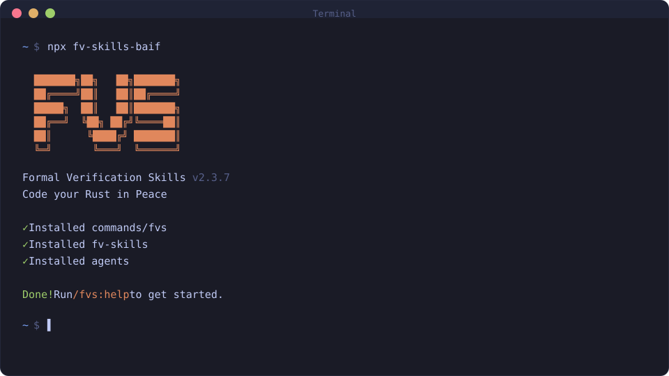

# Formal Verification Skills

FVS helps AI coding assistants write Lean 4 specifications and proofs. The functional-correctness
track verifies Rust translated by Aeneas. The paper track formalises mathematics and cryptography
directly from papers. You choose the targets, review the statements and decide when proof work begins.

[](https://www.npmjs.com/package/fv-skills-baif)
[Pi package](https://pi.dev/packages/fv-skills-baif) · [MIT license](LICENSE)



## Getting started

Run `npx fv-skills-baif` for an interactive installation, or select your runtime explicitly:

| Runtime | User/global install | Help after restarting the session |
|---|---|---|
| Pi | `npx fv-skills-baif --pi --global` | `/skill:fvs-help` |
| Claude Code | `npx fv-skills-baif --claude --global` | `/fvs:help` |
| Codex | `npx fv-skills-baif --codex --global` | `$fvs-help` |
| Antigravity (agy) | `npx fv-skills-baif --antigravity --global` | `/fvs:help` |
| OpenCode | `npx fv-skills-baif --opencode --global` | `/fvs-help` |

Replace `--global` with `--local` to install for the current project. Non-Pi installs copy the
commands and support files into the runtime's configuration directory. Use
`npx fv-skills-baif --help` for custom directory options. Keep one FVS installation per runtime.

Antigravity gets a native agy plugin in `~/.gemini/config/plugins/fvs/` (or `.agents/plugins/fvs/`
in the project), loaded after restarting agy. `--gemini` was removed with the retired Gemini CLI;
installing or removing with `--antigravity` also clears an old FVS Gemini install.

### Pi

The installer delegates to Pi's native package manager. You can also use it directly:

```bash
pi install npm:fv-skills-baif
pi install npm:fv-skills-baif --local
pi update npm:fv-skills-baif
```

Project packages require project trust and take precedence over the user installation.
The default `latest` source stays updateable. `--pi-version X.Y.Z` selects a chosen published version;
X.Y.Z is a metavariable. Exact pins are skipped by `pi update`; rollback means reinstalling a chosen
published pin. If FVS exists in the opposite scope, choose keep, move or cancel. Scripts must pass
`--pi-conflict keep` or `--pi-conflict move`. Pi owns its settings paths, so `--config-dir` does not
redirect them. See [Pi package documentation](https://github.com/earendil-works/pi/blob/main/packages/coding-agent/docs/packages.md).

### Claude Code and Codex marketplace

Install from the [BAIF catalog](https://github.com/Beneficial-AI-Foundation/plugins):

```bash
claude plugin marketplace add Beneficial-AI-Foundation/plugins
claude plugin install fvs@beneficial-ai-foundation
codex plugin marketplace add Beneficial-AI-Foundation/plugins
codex plugin add fvs@beneficial-ai-foundation
```

Claude's default is user scope; `--scope project` and `--scope local` select plugin scopes.
Codex has its own plugin interface; do not reuse Claude's scope flags. After restarting, use
`/fvs:help` in Claude or `$fvs:help` in Codex.

The Codex marketplace ships specialist prompts as Markdown without registering Codex agent roles.
FVS warns when a requested role is missing. A settings-independent step may use a labelled generic
agent with the full specialist prompt; its identity, sandbox, model and reasoning effort are not
guaranteed. A settings-dependent step stops before dispatch or file writes. Registered roles also
need their settings checked.

The npm installer supplies a complete, separately managed Codex installation with roles, hooks and
configuration. To switch channels, remove the plugin first:

```bash
codex plugin remove fvs@beneficial-ai-foundation
npx fv-skills-baif --codex --global
```

Plugin updates, including `$fvs:update`, do not register roles or run the npm installer.

### Before your first Lean task

Use a Lean project with `lakefile.lean` or `lakefile.toml` and its existing `lean-toolchain` pin.
For Rust verification, supply Aeneas-generated `Types.lean` and `Funs.lean`, or start with
`/fvs:aeneas-extract`. Papers need no Rust or Aeneas. NotebookLM integration via `/fvs:kb-setup` is optional.

We recommend [lean-lsp-mcp](https://github.com/oOo0oOo/lean-lsp-mcp) for goal states and diagnostics.
Configure it in your chosen runtime and check that the writing agent can access it; IDE diagnostics
alone do not provide goal states. If live feedback is required but unavailable, the task stops.
Compiler-only work needs your explicit acceptance of that fallback. Project build, style and trust
checks still apply. [Practical Lake builds](fv-skills/references/lake-build.md) explains targeted
checks, import artifacts and caches without changing your project's toolchain or dependency pins.

FC dependency graphs use [probe-aeneas](https://github.com/Beneficial-AI-Foundation/probe-aeneas).
`/fvs:map-code` and `/fvs:fc-plan` first check your project's probe/toolchain combination and print
readable setup diagnostics, so you never need to read the compatibility data yourself. If the
combination is not verified, they offer probe setup, continuing without a graph, or cancelling.
Verified mapping writes the function inventory and progress to `.formalising/CODEMAP.md`.
Unsupported platforms or unverified probe/toolchain combinations cannot produce a verified graph.
SPQR compatibility is not supported. Tools are not installed automatically, and runtime installation
alone does not establish tool access.

The optional verified probe workflow supports tested toolchain combinations on macOS arm64
and Linux x86_64. Linux requires native tools, an absolute Linux-only `PATH`, `/usr/bin/xz`,
and `/usr/bin/bwrap` with working unprivileged namespaces, `--disable-userns`, and seccomp.
FVS does not install these
prerequisites or change system security policy; unavailable confinement stops execution.
The receipt records preparation requirements and indexing/proof limitations. Native Windows
and Linux arm64 remain unsupported.

Linux extraction stages an independent project copy and keeps tool homes read-only.
Helper executable or library links through an intermediate symlink are rejected during resolution.
Malformed `.git` pointer files and symlinked `.git` entries are unsupported and rejected;
ordinary linked Git worktrees remain supported with read-only external Git metadata.

FVS asks for runtime, model and effort choices at each relevant stage. Requested settings,
resolved settings and observed settings are recorded separately; unavailable observations are stated
explicitly. Use `/fvs:configure` to save defaults. See [model profiles](fv-skills/references/model-profiles.md)
for selection rules and runtime limitations.

## Workflows

### Functional correctness

```text
/fvs:natural-language → /fvs:lean-specify → automatic fresh /fvs:lean-spec-review
                                                   ↓ when you request proof work
                                             /fvs:lean-verify → repeat
```

Use `/fvs:map-code` to map dependencies and `/fvs:fc-plan` to choose targets in dependency order.
The FC prover works on its own within a wall-clock budget, checks its own builds and reports
VERIFIED only after a cheat audit. Finish with `/fvs:lean-refactor` and `/fvs:trust-audit`.
`/fvs:model-external` handles external Rust stubs with separate model and specification reviews,
reversible writes, proof completion and a trust audit.

### Papers and crypto

```text
/fvs:crypto-plan → automatic fresh /fvs:crypto-review → /fvs:crypto-execute
       ↑                                               (when you request it)
/fvs:crypto-followup ← /fvs:crypto-eval ←────────────────────┘
       └──────────── automatic fresh review before execution
```

`/fvs:lean-formalise` creates definitions and specification skeletons in one pass. For larger work,
the crypto loop uses a dedicated whole-unit executor. Evaluation returns ACCEPT, FOLLOWUP,
HUMAN_RULING or BLOCKED; unresolved human rulings and blockers stop the loop.
Thinking stages can explicitly use `--codex`; execution has no such flag. An unavailable requested
runtime requires a new choice rather than a silent fallback.

Both tracks use a fresh read-only reviewer and immutable review evidence. The author owns triage
and accepted edits. Approval after edits requires the prescribed checks; revision rounds are bounded.
Skipped, disabled, failed or pending review does not approve a statement or start proof/execution.
You can opt out of automatic review and explicitly request trusted-path work while retaining its
unreviewed status. Review can also use Google's Argon through the Antigravity CLI (`agy`). An Argon
review sends the review packet (your sources and plans) to Google under your own agy account terms,
and on consumer accounts Google may use that content. See [review policy](fv-skills/references/review-policy.md),
[FC statement review](fv-skills/references/fc-spec-review.md) and
[crypto plan review](fv-skills/references/crypto-plan-review.md).

The learning store lives in `.formalising/proof-engineering/`. Commands read `index.md` first,
load at most eight relevant lessons from `lessons/` (`fc/`, `crypto/`, `shared/`) as untrusted data,
and propose at most three evidence-backed updates. Fresh crypto review remains memory-blind.
[Learning-store details](fv-skills/references/proof-engineering-loop.md).

## Commands

The table uses Claude command notation. Use the help entry for your channel to find its spelling
and arguments. Bundle routers list their members when invoked without arguments.
[Full command help](commands/fvs/help.md).

| Bundle | Members |
|---|---|
| `/fvs:aeneas` | `/fvs:aeneas-extract`, `/fvs:model-external`, `/fvs:sync-aeneas-verif` |
| `/fvs:context` | `/fvs:map-code` |
| `/fvs:fc` | `/fvs:fc-plan`, `/fvs:natural-language`, `/fvs:lean-specify`, `/fvs:lean-spec-review`, `/fvs:lean-verify`, `/fvs:lean-refactor`, `/fvs:model-external`, `/fvs:trust-audit` |
| `/fvs:formalise` | `/fvs:lean-formalise`, `/fvs:lean-refactor`, `/fvs:crypto-plan`, `/fvs:crypto-review`, `/fvs:crypto-execute`, `/fvs:crypto-eval`, `/fvs:crypto-followup` |
| `/fvs:manage` | `/fvs:help`, `/fvs:configure`, `/fvs:update`, `/fvs:reapply-patches`, `/fvs:kb-setup`, `/fvs:roadmap` |

## Updates and removal

Use your channel's FVS update command, or rerun the npm installer with `fv-skills-baif@latest` and
the same runtime/scope flags. `/fvs:reapply-patches` helps retain local customizations.
For marketplace updates:

```bash
claude plugin marketplace update beneficial-ai-foundation
claude plugin update fvs@beneficial-ai-foundation
codex plugin marketplace upgrade beneficial-ai-foundation
codex plugin add fvs@beneficial-ai-foundation
```

Remove an npm installation with the same runtime/scope and `--uninstall`, for example
`npx fv-skills-baif --claude --local --uninstall`. For Pi, use `pi remove npm:fv-skills-baif`
for the user installation or `pi remove npm:fv-skills-baif --local` for the project. Unified Pi removal
also supports `npx fv-skills-baif --pi --global --uninstall` (or `--local`). Remove a marketplace
installation with its host's `plugin remove fvs@beneficial-ai-foundation` command.

If you use the skills CLI, it reports each install to skills.sh: the CLI version, the public
repository, the skill names and their paths in it, and the target agents, plus, when they apply, a
global-install flag, the name of the AI agent running the CLI, a CI flag and any `--metadata` you
pass. skills.sh sees your IP address; no account, machine ID, local path or file contents are sent.
To opt out, set `DISABLE_TELEMETRY=1` or `DO_NOT_TRACK=1` before invoking it; opting out also turns
off the CLI's security-audit lookup, so retain independent source and integrity checks. See the
[skills CLI FAQ](https://www.skills.sh/docs/faq) and [privacy policy](https://vercel.com/legal/privacy-policy).
The `fvs-setup` entry provides native installation guidance; copying it alone does not install the
full FVS workflows.

## Credits and license

FVS adapts documentation and proof skills from [Aeneas](https://github.com/AeneasVerif/aeneas)
(Apache 2.0; [retained upstream documentation](fv-skills/upstream/aeneas/)). Its distribution
architecture follows [GSD Core](https://github.com/open-gsd/gsd-core). We also use
[probe-aeneas](https://github.com/Beneficial-AI-Foundation/probe-aeneas) and recommend
[lean-lsp-mcp](https://github.com/oOo0oOo/lean-lsp-mcp). The Lake reference credits its source talk.
[Jin Xing Lim](https://github.com/jinxinglim) proposed independent crypto-plan review and its reviewer prompt.

MIT. See [LICENSE](LICENSE).
