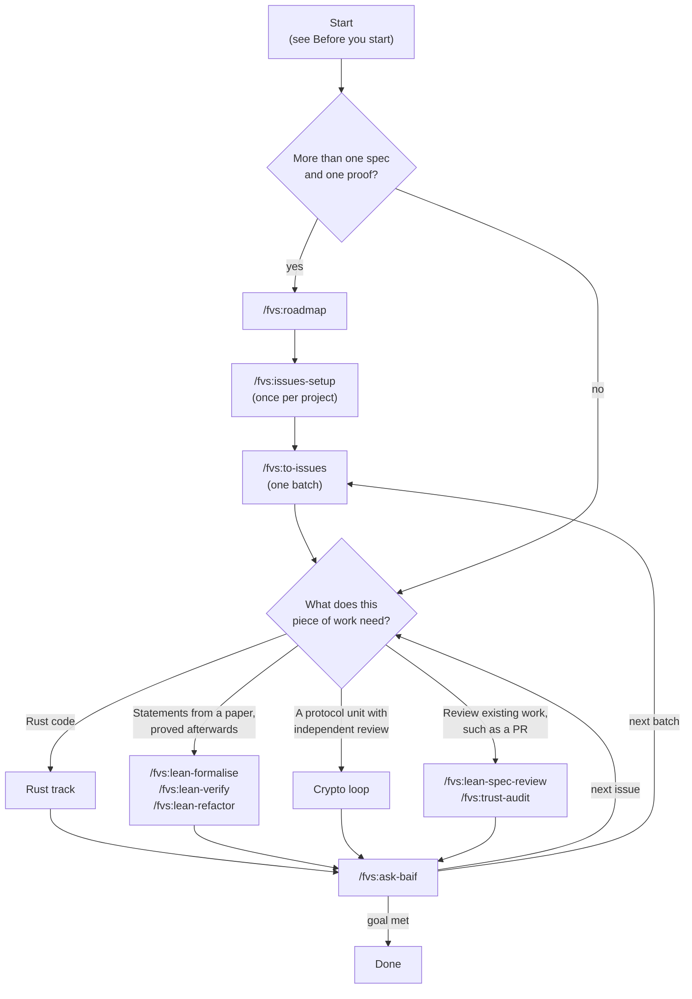
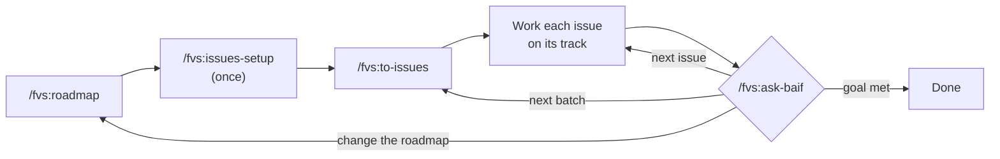
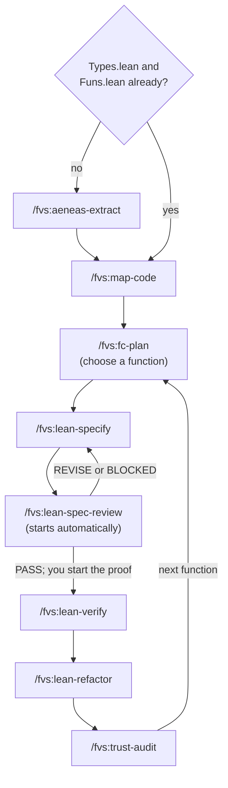
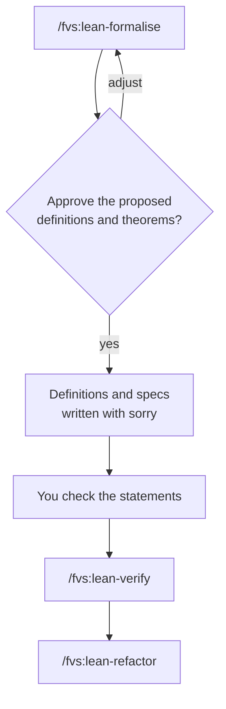
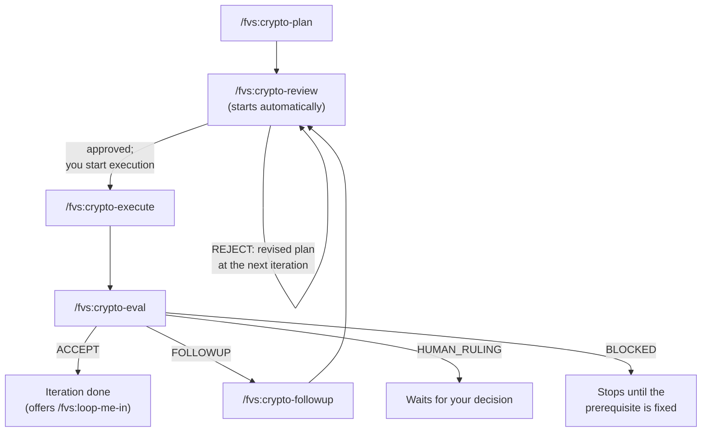

# A typical FVS project

This guide follows an FVS project from a goal to checked proofs: which command to run next, what it
writes, and where it stops for you. The [README](../README.md) covers installation and setup, and
`/fvs:help` lists every command with its arguments.

Commands are written in Claude Code notation, such as `/fvs:lean-verify`. Other runtimes spell them
differently; the help entry for your runtime in the README shows the local spelling.

## Choose a starting point

Most projects start with planning: a roadmap, then issues in batches. Each issue then takes one of
three tracks, depending on the work it needs, and `/fvs:ask-baif` points you to the next issue or
batch. Work that fits in one `/fvs:lean-specify` and one `/fvs:lean-verify` can skip the planning.



Use `/fvs:lean-formalise` when you will check the statements yourself before proving them. Use the
crypto loop for larger protocol or crypto units, where an independent reviewer checks the plan and
an adversarial evaluation checks the result. At any point you can also save or restore a session,
checkpoint your progress, or ask for a walkthrough of recent work; see
[Between sessions](#between-sessions).

The table gives the first command for a single target, or for each issue once the project is
planned.

| You have | Start with | Then |
|---|---|---|
| Anything larger than one spec and one proof | `/fvs:roadmap` | [Plan the project](#plan-the-project), then a track for each issue |
| A Rust crate to verify | `/fvs:aeneas-extract` | [Rust track](#rust-functional-correctness) |
| Aeneas output already (`Types.lean`, `Funs.lean`) | `/fvs:map-code` | [Rust track](#rust-functional-correctness) |
| A section of a paper to state in Lean, then prove | `/fvs:lean-formalise` | [Paper: formalise, then prove](#paper-formalise-then-prove) |
| A protocol or crypto unit that needs independent review | `/fvs:crypto-plan` | [Crypto loop](#crypto-loop) |
| Someone else's specs or pull request to review | `/fvs:lean-spec-review` | [Review commands](#review-commands) |
| A project in progress and no clear next step | `/fvs:ask-baif where are we?` | The command it suggests |

Most records live under `.formalising/` in your project, and Rust extraction also keeps records at
the crate root, so you can stop after any step and pick up later.

## Before you start

The commands that write or build Lean need a Lean project with a lakefile, a `lean-toolchain` pin
and Mathlib among its dependencies. FVS has no setup command: for a paper, create a
[Mathlib project](https://leanprover-community.github.io/install/project.html); for Rust, follow
the Lean backend steps in the [Aeneas README](https://github.com/AeneasVerif/aeneas#readme). The
planning commands work without a Lean project.

[lean-lsp-mcp](https://github.com/oOo0oOo/lean-lsp-mcp) is recommended, not required: it shows the
agents goal states while they write Lean, and without it they ask before continuing on compiler
feedback alone. Optional: `/fvs:configure` saves model defaults, `/fvs:kb-setup` connects a
NotebookLM knowledge base for paper work, and
[probe-aeneas](https://github.com/Beneficial-AI-Foundation/probe-aeneas) gives the Rust track its
verified dependency graph.

## Plan the project

The roadmap is for verification work too large for one `/fvs:lean-specify` plus one
`/fvs:lean-verify`, which covers most projects. Skip this section only when the work fits in those
two commands.



```text
/fvs:roadmap "<goal>"          # once; rerun to refine
/fvs:issues-setup              # once per project
/fvs:to-issues <ROADMAP.md>    # one batch of issues at a time
/fvs:ask-baif where are we?    # after each issue and each batch
```

`/fvs:roadmap` asks clarifying questions, then writes `.formalising/fv-plans/<topic>/ROADMAP.md`.
The roadmap records the claims to establish, the assumptions and trust boundaries, and a list of
milestones. Each milestone names the check that decides it is done, for example `/fvs:lean-verify`
returning VERIFIED, `/fvs:trust-audit` returning CLEAN, or `/fvs:crypto-eval` returning ACCEPT.
Before writing, FVS checks whether git would track the file. If it would, you choose between adding
`.formalising/` to the repository's local exclude file, writing it anyway, or cancelling. A rerun
appends to the roadmap's logs and never rewrites a recorded decision.

`/fvs:issues-setup` records where issues go, GitHub or local Markdown, in
`.formalising/fvs-config.json`.

`/fvs:to-issues` drafts one batch of issues from the roadmap, quizzes you on the breakdown, and shows
the whole batch before creating anything. Local issues are written to `<roadmap dir>/issues/`.
GitHub issues need your consent for that exact batch.

Each issue is one outcome you can review on its own, with its blockers, the evidence that settles
it, and a "done when" checked by an FVS command where one applies. Pick the track for each issue
from the work it describes: a Rust function goes through the Rust track, a section of a paper
through `/fvs:lean-formalise`, and a protocol unit through the crypto loop. One project can use all
three.

`/fvs:ask-baif` reads the roadmap, the issues and the project state, then suggests one next command.
Run bare or with a question, it only advises. Other modes change your tracker: `reconcile` corrects
the status of existing issues, and `take next` also reserves one issue for you. With your
authorisation, `continue` hands off that one suggested step. You can run any command directly
without it. Closing an issue doesn't accept a proof; acceptance still comes from the track's own
checks.

When a batch is finished, `/fvs:ask-baif` compares the evidence so far with the roadmap's goal. It
then reports that the goal is met, points to issues that are still ready, or proposes another
`/fvs:to-issues` batch or a change to the roadmap.

## Rust: functional correctness



The optional steps, `/fvs:model-external` and `/fvs:natural-language`, are left out of the diagram.

```text
/fvs:aeneas-extract <crate>         # skip if you already have Types.lean and Funs.lean
/fvs:model-external <stub>          # only when an external Rust function blocks you
/fvs:map-code
/fvs:fc-plan                        # repeat from here for each function
/fvs:natural-language <function>    # optional
/fvs:lean-specify <function>        # statement review starts automatically
/fvs:lean-verify <spec.lean>
/fvs:lean-refactor <spec.lean>
/fvs:trust-audit <spec.lean or subtree>
```

1. **Extract.** `/fvs:aeneas-extract` runs Charon and Aeneas on a crate, folder or file. When
   extraction fails, it classifies the failure and tries fixes: by default up to three per blocker,
   within a cap of about 25 cycles per run. If the same failure comes back after a fix, it escalates
   to you straight away. A source change that could alter what the extracted code means goes to an
   independent assessor and waits for your ratification. FVS never edits the generated `Types.lean`
   and `Funs.lean`. Each change is recorded at the crate root (`src-modifications.diff`, `.json` and
   `.md`, plus `src-assumptions.md`), and rerunning the command resumes from those records.
2. **Model external functions.** When the code depends on an external Rust function that Aeneas left
   as a stub, `/fvs:model-external` writes a Lean model from the locked source, reviews the model and
   its specification separately, proves it and audits it. It stops on unsafe Rust, and asks you to
   rule on functions with observable effects.
3. **Map.** `/fvs:map-code` lists the functions and their dependencies in `.formalising/CODEMAP.md`.
   If your probe and toolchain combination isn't a verified one, it offers to set up probe, continue
   without a graph, or cancel. Without a graph, `map-code` and `fc-plan` write qualitative notes to
   `.formalising/CODEMAP-exploratory.md` and `.formalising/PLAN-exploratory.md` instead, and
   `trust-audit` can't build its table or give a verdict.
4. **Choose a target.** `/fvs:fc-plan` refreshes the graph and progress facts in `CODEMAP.md`, writes
   recommendations to `.formalising/PLAN.md` and helps you pick a function. The recommendations don't
   certify that a function's dependencies are already proved.
5. **Explain (optional).** `/fvs:natural-language` writes a plain-English account of a function, with
   its pre- and postconditions, to `.formalising/stubs/`.
6. **Specify.** `/fvs:lean-specify` writes `Specs/<path>/<Function>.lean` with the theorem and a
   `sorry`. A fresh reviewer then checks the statement against the Rust and the extracted Lean. FVS
   recommends a reviewer from a different provider than the one that wrote it, and you confirm the
   reviewer, model and effort. PASS moves on; REVISE or BLOCKED sends the statement back, for up to three rounds.
7. **Prove.** `/fvs:lean-verify` works through every `sorry` on its own within a time budget (4 hours
   by default; change it with `--budget 2h`). It reports VERIFIED only after a green build and a cheat
   audit, which checks that the proof uses no axioms beyond `propext`, `Classical.choice` and
   `Quot.sound` and leaves the statement, definitions and extracted code unchanged. Otherwise it
   reports PARTIAL or STUCK. It asks you before changing a theorem statement, and when it runs out of
   budget or gets stuck.
8. **Shorten.** `/fvs:lean-refactor` reduces the proof code. Before editing, it proposes which
   statements and definitions must stay fixed and which files it may change.
9. **Audit.** With a verified probe graph, `/fvs:trust-audit` builds the target and lists every
   `sorry` and axiom it depends on in `.formalising/audits/<target>.md`. The result is NOT-CLEAN
   while any project axiom lacks a justification.

## Paper: formalise, then prove

Use this path when part of a paper should become Lean definitions and theorem statements that you
check yourself and then prove. For a protocol or crypto unit that needs an independent reviewer on
the plan and the result, use the [crypto loop](#crypto-loop).



```text
/fvs:kb-setup                   # optional, once
/fvs:lean-formalise
/fvs:lean-verify <spec.lean>
/fvs:lean-refactor <file.lean>
```

`/fvs:lean-formalise` asks for the task, the source material and the module path. Source material
can be PDFs, images, Markdown or LaTeX, by default from `.formalising/resources/`. It shows you the
definitions, theorems and file layout it plans to write, and writes definition and spec files with
`sorry` placeholders once you approve. This track has no fresh-reviewer step, so check the statements
yourself before proving them. Then prove with `/fvs:lean-verify` and shorten with
`/fvs:lean-refactor`, as in the Rust track.

## Crypto loop

The crypto loop takes a bounded protocol or crypto unit from plan to proof, in iterations (`n1`,
`n2`, ...) under a topic name. An independent reviewer checks each plan before it runs, and an
adversarial evaluation checks the result.



```text
/fvs:crypto-plan "<topic>"           # plan review starts automatically
/fvs:crypto-execute "<topic>" nN     # nN is the iteration the review approved
/fvs:crypto-eval "<topic>" nN
/fvs:crypto-followup "<topic>" nN    # after FOLLOWUP; review starts automatically
```

- **Plan.** `/fvs:crypto-plan` reads the paper through the knowledge base and writes `PLAN_nN.md`
  and a bounded `EXEC_PLAN_nN.md` to `.formalising/fv-plans/<topic>/plans/`. Without a working
  knowledge base, it stops and asks whether to plan ungrounded.
- **Review.** `/fvs:crypto-review` then runs a fresh reviewer against the plan. The reviewer doesn't
  see FVS's stored lessons, so its critique stays independent. You choose the reviewer, model and
  effort. APPROVE-WITH-EDITS proceeds after the edits. REJECT produces a revised plan at the next
  iteration number, which is reviewed again, for up to three rounds. Use the iteration number and
  next command the review reports, not the one you started with.
- **Execute.** `/fvs:crypto-execute` carries out the plan and stops if the build breaks. It runs only
  when you start it.
- **Evaluate.** `/fvs:crypto-eval` writes `reviews/EVAL_nN.md`, which ends in one verdict:

  | Verdict | What happens next |
  |---|---|
  | ACCEPT | The iteration is done. FVS offers `/fvs:loop-me-in` to walk you through what changed. |
  | FOLLOWUP | `/fvs:crypto-followup` turns the findings into `FOLLOWUP_PLAN_nN.md`, which is reviewed and executed like the first plan. |
  | HUMAN_RULING | A modeling decision only you can make. The loop waits for you. |
  | BLOCKED | A prerequisite is missing. The loop stops. |

Start the next iteration by running `/fvs:crypto-plan "<topic>"` again. It reads the records and
picks the next number.

`--codex` on `crypto-plan`, `crypto-eval` and `crypto-followup` runs that stage's thinking in the
Codex CLI and leaves execution where it is. Run from Claude Code, that puts thinking and execution
on different engines. `/fvs:protocol-prose <file-or-topic>` revises module docs and docstrings
against the paper without changing the Lean.

## Review commands

Two commands send work to a fresh, read-only reviewer. Each runs automatically inside its track,
and you can also run it on its own.

| Command | What it reviews | Runs automatically after |
|---|---|---|
| `/fvs:lean-spec-review <spec.lean>` | An FC theorem statement, against the Rust code, the extracted Lean and the interpretation definitions | `/fvs:lean-specify` |
| `/fvs:crypto-review <topic> nN --target plan` (or `followup`) | A crypto plan, before it runs | `/fvs:crypto-plan`, `/fvs:crypto-followup` |

FVS recommends a reviewer from a different provider than the author, then asks you to confirm the
reviewer, model and effort. You can set them directly with
`--reviewer codex|claude|pi|opencode|antigravity|other`, `--model` and `--effort`.
`antigravity` runs Google's Argon through `agy` and sends the review packet to Google under your
agy account's terms. `other` exports the review packet for a model you run yourself, then imports
its reply. Each review keeps an unchanged `review.md`, and the author's triage goes in a separate
file. `/fvs:configure` saves a default reviewer, model and effort under `spec_review` and
`crypto_review` in `.formalising/fvs-config.json`; setting `"automatic": false` there stops the
automatic launch.

To review someone else's work, such as a pull request, check out the branch and run
`/fvs:lean-spec-review` on each spec it adds or changes. For a spec FVS didn't write, it shows the
full reviewer menu and makes no claim that the reviewer is independent of the author. Then run
`/fvs:trust-audit` on the target to list every `sorry` and axiom it depends on.
`/fvs:crypto-review` only reviews FVS crypto plans, so it doesn't apply to other changes.

`--codex` on `crypto-plan`, `crypto-eval` and `crypto-followup` is a different option: it runs that
stage's own thinking in Codex instead of sending the result to a reviewer.

## Between sessions

- `/fvs:pause-work [note]` writes a handoff to `.formalising/fv-plans/.continue-here.md`, or to the
  topic directory you name. `/fvs:resume-work` picks it up.
- `/fvs:checkpoint "<what you verified>"` stages `.formalising/` and the proof files git already
  tracks, shows you the staged diff, and after your approval commits everything staged, including
  anything you staged earlier. New spec files aren't tracked yet, so stage them yourself first. It
  reports the number of open proof gaps once it has committed.
- `/fvs:loop-me-in` writes an HTML walkthrough of the last chunk of work, with a quiz, to
  `.formalising/loop-me-in/`. `/fvs:loop-me-in --final` explains the whole project at the end.
- `/fvs:ask-baif where are we?` summarises the goal, the current state and any blockers.

## Where FVS stops for you

| Stop | Your decision |
|---|---|
| Statement or plan review (`lean-spec-review`, `crypto-review`) | Choose the reviewer, then accept edits or revise. Skipping marks the spec or plan Unreviewed, and proof or execution won't start from it unless you ask explicitly. |
| Before proof or execution | `/fvs:lean-verify` and `/fvs:crypto-execute` start only when you run them or authorise them, for example through `/fvs:ask-baif continue`. |
| `crypto-plan` without a working knowledge base | Set one up with `/fvs:kb-setup`, or continue with labelled, ungrounded planning. |
| A Lean-writing step without lean-lsp-mcp | Set it up, or accept compiler feedback alone. |
| An extraction fix that could change meaning | Ratify or reject it. |
| `lean-verify` wants to change a statement, or runs out of budget | Allow the change, extend the budget, or stop. |
| HUMAN_RULING from the crypto loop or `model-external` | Make the modeling decision. |
| `to-issues` batch preview | Approve the batch before any issue is created. |

FVS never pushes, merges or opens a pull request. `/fvs:checkpoint` is the only command that
commits, and only after you approve the staged diff; everything else FVS writes stays uncommitted in
your working tree.

## Project files

```text
.formalising/
├── fvs-config.json      # saved settings: models, review defaults, issue tracker, knowledge bases
├── CODEMAP.md           # Rust track: functions, dependencies, verification status
├── PLAN.md              # fc-plan recommendations
├── stubs/               # natural-language explanations
├── spec-reviews/        # statement review records
├── audits/              # trust-audit tables
├── model-external/      # external-model evidence
├── extract/             # default extraction workspace (extract_workspace in fvs-config.json)
├── resources/           # papers and notes for lean-formalise
├── fv-plans/<topic>/    # roadmap, local issues, crypto iterations, handoffs
├── proof-engineering/   # lessons FVS records and reuses across sessions
└── loop-me-in/          # walkthroughs
```

Specs and proofs live in your project's source tree, such as `Specs/`, not under `.formalising/`.
Rust extraction records (`src-modifications.*` and `src-assumptions.md`) sit at the crate root.
